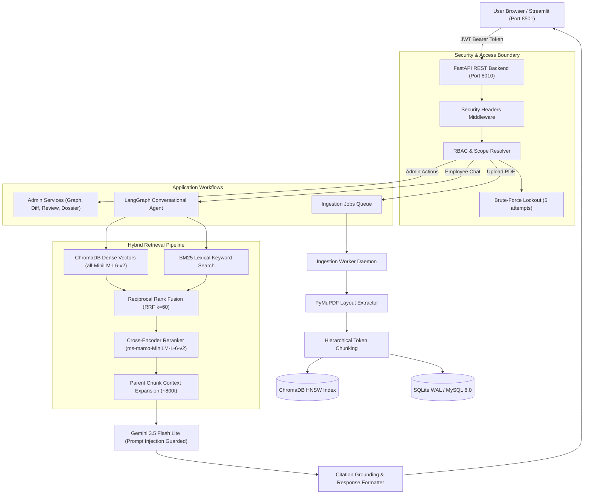

# Enterprise Knowledge Navigator (EKN)

> **Your organization's knowledge, in one place.**

Enterprise-grade document intelligence platform for technical manuals, engineering specifications, operating procedures, and compliance documentation.

---

## Table of Contents

1. [Project Overview](#1-project-overview)
2. [Problem Statement](#2-problem-statement)
3. [Solution](#3-solution)
4. [Key Features](#4-key-features)
   - [Administrator Portal](#administrator-portal)
   - [Employee Portal](#employee-portal)
5. [Technology Stack](#5-technology-stack)
6. [System Architecture](#6-system-architecture)
7. [Administrator Workflow](#7-administrator-workflow)
8. [Employee Workflow](#8-employee-workflow)
9. [RAG Architecture & Document Pipeline](#9-rag-architecture--document-pipeline)
10. [Authentication & Enterprise Security](#10-authentication--enterprise-security)
11. [Project Structure](#11-project-structure)
12. [Prerequisites](#12-prerequisites)
13. [Local Installation](#13-local-installation)
14. [Environment Configuration](#14-environment-configuration)
15. [Running the Application](#15-running-the-application)
16. [Testing & Verification](#16-testing--verification)
17. [Database & Storage Architecture](#17-database--storage-architecture)
18. [Production Deployment & Operational Runbook](#18-production-deployment--operational-runbook)
19. [Troubleshooting Guide](#19-troubleshooting-guide)
20. [Current Project Status & Limitations](#20-current-project-status--limitations)
21. [License & Acknowledgements](#21-license--acknowledgements)

---

## 1. Project Overview

**Enterprise Knowledge Navigator (EKN)** is an end-to-end, multi-tenant AI document intelligence and conversational question-answering platform designed for high-stakes enterprise domains (aerospace, manufacturing, energy, legal, and compliance).

Modern enterprises accumulate thousands of mission-critical PDF documents: operating manuals, maintenance advisories, safety standards, research publications, and legal filings. Finding accurate, up-to-date answers across these disparate files typically requires manual searching and cross-referencing. Standard generative AI tools hallucinate details, lack document provenance, and fail to alert users when a specification has been modified or superseded in a newer document revision.

EKN resolves these issues by establishing a centralized organizational knowledge base with:
- **Verifiable Evidence Grounding:** Answers cite exact document names, version numbers, and page references with verbatim source excerpts.
- **Document Version Intelligence:** Automated side-by-side AST and semantic diffing that identifies parameter changes, added/removed clauses, and conflicting guidelines across revisions.
- **Cross-Document Knowledge Graphs:** Automated entity extraction (Systems, Equipment, Parameters, Standards, Organizations) that maps relationships across documents with verifiable evidence trails.
- **Executive Dossier Generation:** Publication-grade PDF brief generation on demand with dynamic two-pass page numbering (`Page X of Y`).
- **Fail-Closed Multi-Tenancy & Privacy:** Strict separation of company knowledge from private employee documents, protected by server-side role validation and fail-closed HTTP 404 boundaries.

---

## 2. Problem Statement

EKN addresses the acute bottlenecks organizations encounter when managing critical technical documentation:

1. **Scattered PDF Silos:** Operational procedures, safety policies, and technical specifications are isolated across disparate network shares and individual workstations without unified semantic search.
2. **AI Hallucinations & Lost Provenance:** Generic LLM interfaces fabricate parameters, blend unrelated concepts, and fail to provide exact page-level citations for audits.
3. **Superseded Revisions & Silent Contradictions:** When an operational threshold (e.g., turbine inlet temperature or lubrication pressure) is revised in a newer manual, naive retrieval often serves the obsolete figure without warning the operator.
4. **Repeated Manual PDF Searching:** Engineers and employees waste hours manually locating, reading, and verifying passages across hundreds of dense multi-page manuals.
5. **Lack of Evidence-Backed Conflict Review:** Organizations lack automated tooling to detect and track operational contradictions between documents before they cause field incidents.
6. **Privacy & Tenant Security Risks:** Standard shared document repositories frequently expose personal drafts and unreleased internal notes across organizational boundaries.

---

## 3. Solution

EKN provides an integrated, dual-experience enterprise platform that bridges organizational governance and employee productivity:

- **For Administrators:** A comprehensive Control Center to ingest company PDFs, monitor background indexing, inspect document version diffs, adjudicate detected contradictions in a dedicated review queue, visualize cross-document knowledge graphs, generate executive dossiers, and manage team access codes.
- **For Employees:** A distraction-free, three-panel conversational workspace to query knowledge in natural language, toggle between verified company files and private personal drafts, inspect verbatim citation passages, view source PDF page previews, and download authorized files.

---

## 4. Key Features

### Administrator Portal

- **Company Workspace Management:** Create and configure distinct multi-tenant workspaces with isolated metadata, relational records, and vector indices.
- **Company PDF Library:** Full catalog of approved organizational documents with pagination, processing status badges (`pending`, `processing`, `completed`, `failed`), and one-click PDF downloads.
- **Streaming Document Ingestion:** Memory-bounded PDF upload pipeline with streaming SHA-256 deduplication to prevent redundant processing.
- **Document Version Intelligence:** Groups document revisions into chronological families, computes deterministic side-by-side text and table diffs, and highlights numerical changes with AI explanations.
- **Knowledge Contradiction Review Queue:** Automated detection of conflicting guidelines across revisions with severity classification (`Critical`, `Warning`, `Info`) and auditable resolution workflows (`Acknowledge`, `Dismiss`, `Resolve`).
- **Cross-Document Knowledge Graph:** NetworkX entity-relationship engine extracting Systems, Equipment, Parameters, Standards, and Organizations with visual ego-graph subgraphs and exportable PNG diagrams.
- **Team & Access Administration:** Manage workspace memberships (`owner`, `admin`, `employee`) and generate time-bounded single-use or multi-use joining codes for self-service onboarding.
- **Executive Knowledge Dossiers:** ReportLab PDF compilation generating executive summaries, document indexes, embedded graph diagrams, and clickable citations.
- **Company Settings:** Configure workspace names, domain branding, upload limits, and member permissions.

### Employee Portal

- **Conversational AI Workspace:** High-contrast, three-panel productivity layout with conversation history, active query streaming, and an evidence inspector.
- **Persistent Chat History:** Searchable, timestamped conversation threads stored in the relational database with custom renaming and deletion controls.
- **Source Scope Selector:** Toggle query scope seamlessly per session:
  - `Company Files`: Searches verified, approved company documentation.
  - `My Files`: Searches exclusively across the employee's private, isolated uploads.
  - `Company + My Files`: Combined hybrid retrieval across both scopes.
- **Personal Document Workspace ("My Files"):** Upload private reference PDFs that remain invisible to administrators and other employees.
- **Strict Evidence Citations:** Every claim is backed by inline bracketed citations `[DocumentName, p. X]`, clickable to view the exact supporting passage.
- **Context & Sources Panel:** Dedicated inspector displaying retrieved passage text, source document metadata, version status (`current` vs. `superseded`), and page references.
- **PDF Preview & Authorized Download:** Built-in PDF reader to inspect source pages and download authorized copies directly from the workspace.

---

## 5. Technology Stack

| Layer | Technology | Version | Purpose |
|---|---|---|---|
| **Runtime** | Python | 3.12+ | Core language runtime across backend, worker, frontend, and tests |
| **REST API Server** | FastAPI | 0.110+ | Asynchronous REST backend with automated OpenAPI documentation |
| **ASGI Server** | Uvicorn | 0.28+ | High-throughput asynchronous server for the REST API |
| **Frontend Framework** | Streamlit | 1.32+ | Interactive enterprise web interface with custom light-indigo design system |
| **Relational Database** | SQLite (WAL mode) / MySQL | 2.0+ (SQLAlchemy) | ACID transactional store for users, workspaces, metadata, versions, and logs |
| **Vector Store** | ChromaDB | 0.5+ | High-dimensional HNSW cosine vector index (`ekn_document_chunks`) |
| **PDF Extraction** | PyMuPDF (`fitz`) | 1.24+ | Digital text, heading hierarchy, table bounding boxes, and page pixmaps |
| **OCR Fallback** | Tesseract OCR (`pytesseract`) | 5.x | Selective OCR fallback triggered only on scanned non-digital pages (<50 chars) |
| **Dense Embeddings** | Sentence Transformers | 3.0+ | `sentence-transformers/all-MiniLM-L6-v2` generating 384-dimensional vectors |
| **Lexical Search** | `rank-bm25` | 0.2.2 | Inverted index search with domain-aware technical tokenization |
| **Neural Reranker** | Cross-Encoder | 3.0+ | `cross-encoder/ms-marco-MiniLM-L-6-v2` scoring query-passage cross-attention |
| **Agentic Workflow** | LangChain & LangGraph | 1.0+ | 9-node cyclic state graph managing query contextualization and citations |
| **Generative LLM** | Google Gemini | 4.0+ (`google-genai`) | `gemini-3.5-flash-lite` for grounded response synthesis and entity extraction |
| **Knowledge Graph** | NetworkX | 3.0+ | In-memory graph model for entity relationships and shortest-path discovery |
| **Data Visualization** | Matplotlib | 3.8+ | Server-side high-resolution rendering of graph subgraphs |
| **PDF Compilation** | ReportLab | 5.0+ | Two-pass dynamic canvas (`Page X of Y`) knowledge dossier PDF generation |
| **Security & Auth** | `argon2-cffi`, `pyjwt` | 23.1+, 2.9+ | RFC 9106 Argon2id credential hashing and `HS256` signed JWT session tokens |
| **Containerization** | Docker, Docker Compose | - | Multi-service production orchestration |

---

## 6. System Architecture

```
+-------------------------------------------------------------------------------------------------+
|                                     PRESENTATION TIER                                           |
|   Streamlit Web Interface (Port 8501)                                                           |
|   - Administrator Control Center (Overview, Documents, Review, Graph, Team, Reports, Settings) |
|   - Employee Conversational Workspace (Three-Panel Layout, Chat History, Context & Sources)    |
|   - Responsive Light-Indigo Design System (#F8FAFC, #FFFFFF, #4F46E5, #172033)                 |
+------------------------------------------------+------------------------------------------------+
                                                 | HTTPS / JWT Bearer Tokens (HS256)
+------------------------------------------------v------------------------------------------------+
|                                      API GATEWAY & SECURITY                                     |
|   FastAPI REST Backend (Port 8010)                                                              |
|   - Security Response Headers Middleware (nosniff, SAMEORIGIN, 1; mode=block, strict-origin)   |
|   - Exception Masking & Information Leakage Defense                                            |
|   - Argon2id Password Hashing & Brute-Force Account Lockout Counter (5 attempts, 15 min lock)   |
|   - Role-Based Access Control (RBAC: Owner, Admin, Employee)                                   |
|   - Fail-Closed Cross-Tenant & Personal Document Boundaries (HTTP 404 Not Found)               |
+----------------------+-------------------------+-------------------------+----------------------+
                       |                         |                         |
+----------------------v------+ +----------------v-------+ +----------------v---------------------+
|      INGESTION & WORKER     | |   HYBRID RETRIEVAL     | |       CONVERSATIONAL RAG            |
|  - Asynchronous Ingestion   | |  - Dense Vector Search | |  - 9-Node LangGraph State Machine   |
|    Daemon (Worker Poll 2.0s)| |    (ChromaDB HNSW)     | |  - Natural Greeting Bypass          |
|  - Worker Heartbeat Tracker | |  - Sparse Keyword BM25 | |  - Query Contextualization          |
|  - PyMuPDF Layout Parsing   | |  - Reciprocal Rank     | |  - Prompt Injection Defense Guard   |
|  - Selective Tesseract OCR  | |    Fusion (RRF k=60)   | |  - Gemini 3.5 Flash Lite Generation |
|  - Hierarchical Chunking    | |  - Cross-Encoder       | |  - Grounding & Citation Validation  |
|    (800t Parent / 200t Child| |    Neural Reranker     | |  - Verbatim Supporting Excerpts     |
+----------------------+------+ +----------------+-------+ +----------------+--------------------+
                       |                         |                         |
+----------------------v-------------------------v-------------------------v----------------------+
|                                     PERSISTENCE TIER                                            |
|  - Relational Database: SQLite (WAL mode) / MySQL 8.0 via SQLAlchemy 2.0 (ACID Metadata, Jobs) |
|  - Vector Store: ChromaDB Persistent Directory (ekn_document_chunks collections)                |
|  - File Storage: Immutable local directory root (storage/uploads, storage/private, reports/)    |
|  - Automated Disaster Recovery: Online WAL Checkpoint Backups & Restore Utilities              |
+-------------------------------------------------------------------------------------------------+
```

### Architecture Flowchart



---

## 7. Administrator Workflow

The Administrator workflow guides knowledge officers and engineering managers through the document governance lifecycle:

1. **Authentication & Identity Selection:** Admin logs in at `/` via the dedicated **Administrator Portal** (`admin.demo@example.com`). Role is verified server-side; non-admin accounts are rejected with HTTP 403.
2. **Workspace Selection & Overview:** Admin enters the company workspace (e.g., *Aerospace & Engineering*). The Overview dashboard surfaces live KPIs: Company Documents, Search-Ready Count, Pending Contradiction Reviews, and Active Employees.
3. **Document Ingestion:** Admin uploads single or multi-file PDFs via drag-and-drop. The backend validates the `%PDF-` magic byte signature, sanitizes filenames against path traversal, and enqueues background ingestion jobs.
4. **Asynchronous Processing:** The Ingestion Worker parses layout and tables with PyMuPDF, executes selective Tesseract OCR on scanned pages, divides text into parent/child chunks, generates 384-dimensional embeddings, and updates the database to `completed`.
5. **Knowledge Library Management:** Admin inspects the catalog of indexed documents, filters by status, reviews page counts and chunk distributions, and downloads original files.
6. **Version Intelligence & Diffing:** Admin groups revisions into document families (e.g., *Turbine Operating Procedures v1 vs. v2*). EKN computes deterministic page-by-page text diffs, flags altered numerical values, and provides LLM-assisted summaries of substantive changes.
7. **Contradiction Review:** Conflicting operational thresholds across revisions are flagged in the review queue. The admin reviews conflicting passages side-by-side and records decisions (`Acknowledge`, `Dismiss`, `Resolve`).
8. **Knowledge Graph Exploration:** Admin queries the workspace entity graph. The visualizer renders interactive ego-graphs showing shared topics, standards, and cross-document dependencies.
9. **Team Management & Onboarding:** Admin views active workspace members and generates secure, time-bounded joining codes (e.g., `JOIN-2BFACE-0F0FD7`) for new employee registration.
10. **Executive Dossier Generation:** Admin triggers on-demand knowledge dossier PDF generation. The ReportLab engine compiles summaries, document indexes, contradiction tables, and embedded graph diagrams into a publication-grade PDF.

---

## 8. Employee Workflow

The Employee workflow provides an intuitive, chat-first experience designed for rapid, trustworthy information retrieval:

1. **Sign-In & Onboarding:** Employee registers with a valid company joining code or signs in at the **Employee Portal** (`employee.demo@example.com`).
2. **Three-Panel Conversational Workspace:**
   - *Left Sidebar:* View past conversations, initiate a new chat, switch workspaces, or view file libraries.
   - *Center Panel:* Conversational query interface with streaming assistant answers.
   - *Right Panel ("Context & Sources"):* Persistent evidence inspector showing exact supporting passages.
3. **Knowledge Scope Selection:** Before or during any chat, the employee selects the search scope:
   - `Company Files`: Restricts search to verified organizational documentation.
   - `My Files`: Restricts search exclusively to the employee's private uploaded documents.
   - `Company + My Files`: Combined hybrid search across both repositories.
4. **Submitting Queries:** Employee enters a natural language question (e.g., *"What is the standard startup sequence for the gas turbine?"*).
5. **Natural Greeting Handling:** Casual greetings (e.g., *"Hello", "Hi"*) are detected and answered immediately without incurring vector retrieval latency.
6. **Evidence-Grounded Answer:** The hybrid retrieval engine locates the top passages across the selected scope. Gemini 3.5 Flash Lite synthesizes a concise, Markdown-formatted answer with inline bracketed citations `[Turbine_Operating_Procedures.pdf, p. 4]`.
7. **Inspecting Citations & Excerpts:** Clicking an inline citation pill or opening the collapsed evidence drawer reveals the verbatim supporting excerpt. The right panel displays full document metadata and version status (`current` vs. `superseded`).
8. **PDF Page Preview & Download:** Employee inspects the rendered source page directly in the browser or downloads the source PDF for offline reference.
9. **Private File Upload ("My Files"):** Employee uploads personal draft PDFs. The files are indexed with `visibility_scope='personal'` and bound to the employee's user ID, remaining completely hidden from other employees and administrators.

---

## 9. RAG Architecture & Document Pipeline

EKN implements an advanced 12-stage Retrieval-Augmented Generation (RAG) pipeline:

```
[1. PDF Ingestion] ────────► [2. Text & Layout Extraction] ──► [3. Selective OCR Fallback]
                                                                        │
[6. Dense & Sparse Storage] ◄── [5. Sentence Embeddings] ◄─── [4. Hierarchical Chunking]
        │
        ▼
[7. Hybrid Query Search] ───► [8. Reciprocal Rank Fusion] ───► [9. Cross-Encoder Reranking]
                                                                        │
[12. Conversation Storage] ◄── [11. Citation Validation] ◄──── [10. Gemini Generation]
```

1. **Streaming PDF Ingestion:** Memory-efficient file stream processing. Uploads are verified against the `%PDF-` magic signature and stored in tenant-isolated directories with sanitized filenames.
2. **Structural & Layout Extraction:** PyMuPDF (`fitz`) extracts digital text, preserves heading hierarchies, identifies font weights, and detects table structures.
3. **Selective OCR Fallback:** Text density is evaluated per page. If a page contains fewer than 50 characters (e.g., scanned diagrams or blueprints), Tesseract OCR is conditionally triggered on high-DPI page pixmaps.
4. **Hierarchical Chunking:** Documents are segmented into parent-child relationships:
   - *Parent Chunks:* Coarse sections (~800 to 1,000 tokens) preserving narrative context.
   - *Child Chunks:* Fine-grained passages (~200 tokens with 40-token overlap) for high-precision vector and keyword index matching.
5. **Dense Embedding Generation:** Child chunks are vectorized using `sentence-transformers/all-MiniLM-L6-v2` (384-dimensional normalized float vectors) with bounded in-memory LRU caching.
6. **Dual Index Storage:**
   - *Dense Index:* Vectors and metadata are persisted in ChromaDB HNSW collections (`ekn_document_chunks`).
   - *Sparse Index:* Inverted lexical index constructed via BM25 with technical domain tokenization.
7. **Parallel Hybrid Querying:** User queries trigger simultaneous searches: dense semantic vector similarity in ChromaDB and sparse keyword matching in BM25.
8. **Reciprocal Rank Fusion (RRF):** Dense and sparse candidate pools are fused using the RRF algorithm with rank constant $k = 60$:
   $$\text{RRF\_Score}(d) = \sum_{m \in \{\text{dense}, \text{bm25}\}} \frac{1}{k + r_m(d)}$$
9. **Cross-Encoder Neural Reranking:** Top 30 candidate chunks are scored against the user query using `cross-encoder/ms-marco-MiniLM-L-6-v2`. Candidates scoring below relevance thresholds are pruned.
10. **Parent Chunk Expansion:** The top-scoring child chunks are mapped back to their enclosing parent chunks, supplying the LLM with complete contextual boundaries without chunk-boundary fragmentation.
11. **Grounded Generation with Gemini:** The context, system instructions, and conversation history are passed to Google Gemini 3.5 Flash Lite (`gemini-3.5-flash-lite`). System prompts enforce strict grounding, prompt-injection isolation, and honest refusal if evidence is insufficient.
12. **Citation Validation & Persistence:** Assistant responses are parsed for bracketed citations. Citations are verified against retrieved chunk IDs. Both user and assistant turns, citations, and latency metrics are persisted in the relational database.

---

## 10. Authentication & Enterprise Security

EKN incorporates enterprise security controls throughout the application lifecycle:

- **Role-Separated Portals:** Separate `/` entry points for Administrator and Employee logins with server-side role validation.
- **Argon2id Credential Hashing:** Passwords are encrypted using `argon2-cffi` following RFC 9106 parameters (65,536 KiB memory cost, 3 iterations, 4 parallelism lanes).
- **Password Complexity Policy:** Enforces enterprise password standards (minimum 12 characters, uppercase, lowercase, numbers, and special characters).
- **Brute-Force Account Lockout:** 5 consecutive failed login attempts trigger an automated 15-minute database-enforced lockout (`locked_until`). Counter resets on successful authentication.
- **JWT Session Security:** Access tokens signed with `HS256` (15-minute expiration). Rotating refresh tokens are stored as SHA-256 hashes with compromise detection (replaying an expired or revoked token immediately revokes the entire refresh family).
- **Fail-Closed Cross-Tenant Boundaries:** All queries enforce workspace membership checks. Unauthorized requests to foreign workspaces return HTTP 404 Not Found to prevent workspace enumeration.
- **Personal Document Privacy:** Files uploaded under `visibility_scope='personal'` are strictly bound to `owner_user_id == current_user.id`. They are excluded from company search results, excluded from knowledge graph extraction, and cannot be accessed or downloaded by administrators.
- **File Upload Security:** Magic byte inspection requires the `%PDF-` header. Path traversal sequences (`../`, `..\`) and null bytes are stripped before storage.
- **Security Response Headers:** Custom FastAPI middleware applies security headers on every response:
  - `X-Content-Type-Options: nosniff`
  - `X-Frame-Options: SAMEORIGIN`
  - `X-XSS-Protection: 1; mode=block`
  - `Referrer-Policy: strict-origin-when-cross-origin`
- **Exception Sanitization:** Unhandled 500 exceptions in production mode mask internal database schemas and tracebacks, returning a generic error identifier to prevent information leakage.

---

## 11. Project Structure

```
PDF-intelligence/
|-- backend/
|   |-- api/
|   |   `-- v1/                 # FastAPI REST route controllers
|   |       |-- auth.py         # Authentication, login, signup, invitation validation
|   |       |-- conversations.py# Chat lifecycle, message submission, RAG execution
|   |       |-- documents.py    # Document upload, listing, details, download
|   |       |-- graph.py        # Knowledge graph queries, ego-subgraphs, entity search
|   |       |-- members.py      # Member management, role updates, removal
|   |       |-- reports.py      # Dossier report creation, listing, PDF download
|   |       |-- search.py       # Direct hybrid search API endpoint
|   |       |-- versions.py     # Document families, diffs, contradiction review queue
|   |       `-- workspaces.py   # Workspace creation, listing, invitation code generation
|   |-- core/
|   |   |-- dependencies.py     # FastAPI dependency injection (auth, DB, membership)
|   |   |-- health.py           # /health and /ready operational probes
|   |   `-- security.py         # Argon2id hashing, JWT generation, password validation
|   |-- database/
|   |   |-- base.py             # SQLAlchemy DeclarativeBase
|   |   |-- connection.py       # Engine initialization (SQLite WAL / MySQL connection)
|   |   `-- models.py           # 20 relational database models
|   |-- schemas/                # Pydantic v2 validation models for requests and responses
|   |-- services/               # Core business logic services
|   |   |-- audit_service.py    # Security and access event logging
|   |   |-- auth_service.py     # User authentication, token rotation, lockout
|   |   |-- chunking_service.py # Hierarchical parent/child token chunking
|   |   |-- contradiction_service.py # Contradiction detection and severity ranking
|   |   |-- embedding_service.py# SentenceTransformers embedding generation & caching
|   |   |-- extraction_service.py# PyMuPDF text/table parsing & selective OCR
|   |   |-- invitation_service.py# Onboarding joining code lifecycle
|   |   |-- knowledge_graph_service.py # NetworkX graph modeling & entity extraction
|   |   |-- llm_service.py      # Google Gemini 3.5 Flash Lite client & prompts
|   |   |-- rag_service.py      # LangGraph state machine & hybrid retrieval fusion
|   |   |-- report_generation_service.py # ReportLab knowledge dossier PDF compiler
|   |   |-- reranking_service.py# Cross-Encoder neural passage reranking
|   |   |-- retrieval_service.py# Dense ChromaDB + Sparse BM25 + RRF fusion
|   |   |-- storage_service.py  # File persistence and path traversal sanitization
|   |   `-- version_service.py  # Document families, diffing, and change explanation
|   |-- scripts/                # Operational scripts
|   |   |-- backup_database.py  # Automated WAL-checkpointed online database backup
|   |   |-- capture_product_screenshots.py # Headless CDP screenshot verification tool
|   |   |-- restore_database.py # Database disaster recovery restoration tool
|   |   |-- seed_demo_accounts.py # Pre-seeded demo accounts provisioner
|   |   |-- verify_acceptance_workflows.py # 5 end-to-end acceptance workflows runner
|   |   `-- verify_cleanup_integrity.py   # Baseline vs. current data integrity checker
|   |-- main.py                 # FastAPI application factory and middleware configuration
|   `-- worker.py               # Asynchronous ingestion worker daemon
|
|-- frontend/
|   |-- views/                  # Streamlit view modules
|   |   |-- citation_viewer.py  # Citations inspector, source passages, PDF viewer
|   |   |-- documents.py        # Admin document library and upload view
|   |   |-- employee_workspace.py # Employee three-panel conversational workspace
|   |   |-- knowledge_review.py # Admin contradiction review queue
|   |   |-- login.py            # Welcome identity selection, Admin and Employee portals
|   |   |-- overview.py         # Admin dashboard with live KPI metrics and timeline
|   |   |-- reports_settings.py # Admin knowledge dossier generator and settings
|   |   `-- team.py             # Admin member management and invitation code generator
|   |-- api_client.py           # Typed Python client communicating with FastAPI
|   |-- navigation.py           # Session-state routing and navigation synchronization
|   |-- streamlit_app.py        # Streamlit entry point
|   `-- styles.py               # Responsive light-indigo design system and custom CSS
|
|-- config/
|   `-- settings.py             # Pydantic BaseSettings configuration management
|
|-- data/                       # Persistent data directory (excluded from git)
|   |-- backups/                # Verified online SQLite database backups
|   |-- chroma_db/              # Persistent ChromaDB vector collections
|   |-- sample_documents/       # Pre-loaded technical manuals (Turbine Operating Procedures)
|   |-- storage/                # File storage root (uploads, processed, private, reports)
|   `-- ekn.db                  # Primary SQLite transactional database (WAL mode)
|
|-- scripts/
|   |-- start_production.py     # Cross-platform Python multi-process supervisor
|   `-- start_production.sh     # Unix multi-process startup script
|
|-- tests/                      # Automated pytest test suites
|   |-- conftest.py             # Pytest fixtures and mock client setup
|   |-- test_auth_portals_and_demo.py # Portals, role separation, lockout tests
|   |-- test_demo_prefill_login.py    # Demo credential pre-filling tests
|   |-- test_health.py          # Liveness and readiness probe tests
|   |-- test_master_production_hardening.py # Security headers, traversal, isolation
|   |-- test_security.py        # Argon2id, tenant boundary, session rotation tests
|   `-- test_targeted_ui_navigation_and_experience.py # Navigation and UI tests
|
|-- .streamlit/
|   `-- config.toml             # Streamlit server and light theme configuration
|-- Dockerfile                  # Multi-stage production container image
|-- docker-compose.yml          # Multi-service production container topology
|-- requirements.txt            # Pinned runtime and testing dependencies
|-- .env.example                # Sanitized configuration template
|-- .gitignore                  # Git hygiene and secret prevention rules
`-- README.md                   # Primary project documentation
```

---

## 12. Prerequisites

- **Operating System:** Windows 10/11, Ubuntu 22.04+, or macOS Sonoma.
- **Python:** Python 3.12 (recommended) or 3.11+.
- **Database:** SQLite 3 (built into Python; WAL mode enabled automatically) or MySQL 8.0+.
- **OCR Engine (Optional):** Tesseract OCR (required only if ingesting scanned, non-digital PDFs).
  - *Windows:* Install via `winget install UB-Mannheim.TesseractOCR` and add to `PATH`.
  - *Linux:* `sudo apt-get install tesseract-ocr`
- **Web Browser (Optional):** Google Chrome (required only if running the automated CDP headless screenshot capture script).
- **API Key:** A valid Google Gemini API key (`GEMINI_API_KEY`) for conversational answer generation.

---

## 13. Local Installation

### Step 1: Clone Repository
```bash
git clone https://github.com/organization/PDF-intelligence.git
cd PDF-intelligence
```

### Step 2: Create & Activate Virtual Environment

**Windows PowerShell:**
```powershell
python -m venv .venv
.\.venv\Scripts\Activate.ps1
```

**Linux / macOS:**
```bash
python3 -m venv .venv
source .venv/bin/activate
```

### Step 3: Install Dependencies
```bash
pip install --upgrade pip
pip install -r requirements.txt
```

---

## 14. Environment Configuration

Copy the template configuration file:
```bash
cp .env.example .env
```

Edit `.env` to configure your settings:

```dotenv
# Application Identity & Mode
APP_NAME="Enterprise Knowledge Navigator"
ENVIRONMENT=development
DEBUG=true
EKN_DEMO_MODE=true

# API Server Configuration
API_HOST=127.0.0.1
API_PORT=8010
BACKEND_API_URL=http://127.0.0.1:8010

# Database Configuration (SQLite default / MySQL optional)
DATABASE_URL=sqlite:///./data/ekn.db

# Storage Directories
STORAGE_LOCAL_ROOT=./data/storage
UPLOAD_DIR=./data/storage/uploads
PROCESSED_DIR=./data/storage/processed
REPORTS_DIR=./data/storage/reports

# Vector Database & Embeddings
CHROMA_PERSIST_DIRECTORY=./data/chroma_db
CHROMA_COLLECTION_NAME=ekn_document_chunks
EMBEDDING_MODEL=sentence-transformers/all-MiniLM-L6-v2
EMBEDDING_DEVICE=cpu
EMBEDDING_BATCH_SIZE=32

# Hybrid Retrieval & Reranking
CROSS_ENCODER_MODEL=cross-encoder/ms-marco-MiniLM-L-6-v2
RETRIEVAL_DENSE_TOP_K=30
RETRIEVAL_BM25_TOP_K=30
RETRIEVAL_RRF_K=60
RETRIEVAL_FINAL_TOP_K=8

# LLM & Conversational RAG
LLM_PROVIDER=gemini
GEMINI_API_KEY=your_actual_gemini_api_key_here
GEMINI_MODEL=gemini-3.5-flash-lite
LLM_TEMPERATURE=0.2

# Enterprise Security & JWT
JWT_SECRET_KEY=change-this-to-a-secure-random-32-byte-secret-in-production
JWT_ALGORITHM=HS256
ACCESS_TOKEN_EXPIRE_MINUTES=15
REFRESH_TOKEN_EXPIRE_DAYS=7
MAX_FAILED_LOGIN_ATTEMPTS=5
ACCOUNT_LOCKOUT_MINUTES=15
ALLOWED_ORIGINS=http://localhost:8501,http://127.0.0.1:8501
DEMO_WORKSPACE_ID=dc5d9139-f381-4818-ab26-c2e878997b4d
```

> **Security Note:** Never commit `.env` to version control. The repository's `.gitignore` automatically prevents `.env` from being tracked.

---

## 15. Running the Application

### Option A: Multi-Process Production Supervisor (Recommended)

Starts the FastAPI backend, Ingestion Worker daemon, and Streamlit frontend in a unified process tree with graceful shutdown:
```bash
python scripts/start_production.py
```

### Option B: Standalone Service Startup

Run each service in a separate terminal:

**1. Start the FastAPI Backend (Port 8010):**
```bash
uvicorn backend.main:app --host 127.0.0.1 --port 8010
```

**2. Start the Ingestion Worker Daemon:**
```bash
python -m backend.worker
```

**3. Start the Streamlit Frontend (Port 8501):**
```bash
streamlit run frontend/streamlit_app.py --server.port 8501
```

### Option C: Docker Compose

Launch the containerized stack:
```bash
docker-compose up -d
```

Access the application in your browser:
- **Streamlit Web UI:** `http://localhost:8501`
- **FastAPI Interactive Docs (Swagger):** `http://127.0.0.1:8010/docs`
- **Health Probe:** `http://127.0.0.1:8010/health`
- **Readiness Probe:** `http://127.0.0.1:8010/ready`

---

## 16. Testing & Verification

EKN includes an automated test suite covering unit logic, integration boundaries, security hardening, and end-to-end user workflows.

### Run Automated Unit & Security Tests
```bash
# Run the complete test suite
pytest tests/ -v

# Run production security hardening and cross-tenant isolation tests
pytest tests/test_master_production_hardening.py -v

# Run authentication and demo login tests
pytest tests/test_auth_portals_and_demo.py tests/test_demo_prefill_login.py -v

# Run health check probe tests
pytest tests/test_health.py -v
```

### Run Live Acceptance Workflows
Verify all 5 end-to-end workflows against the live running backend:
```bash
python backend/scripts/verify_acceptance_workflows.py
```
*Workflows verified:*
1. Administrator Full Lifecycle (Login, Docs, Diffs, Review Queue, Graph, Invitations, Reports)
2. Employee Conversational Lifecycle (Login, Chat, Greeting Bypass, RAG Query, Scope Switching)
3. Cross-User Security & Private Document Isolation (404 Fail-Closed)
4. Cross-Workspace Tenant Isolation (404 Fail-Closed)
5. Disaster Recovery & Backup Integrity Verification

### Verify Post-Cleanup Data Integrity
```bash
python backend/scripts/verify_cleanup_integrity.py
```

---

## 17. Database & Storage Architecture

### Relational Database
The transactional store manages 20 database tables via SQLAlchemy 2.0:
- `users`, `workspaces`, `workspace_memberships`, `workspace_invitations`, `refresh_sessions`
- `documents`, `document_chunks`, `document_families`, `document_versions`, `version_comparisons`, `contradiction_findings`
- `conversations`, `messages`, `conversation_attachments`
- `entities`, `entity_relationships`, `document_entity_associations`
- `ingestion_jobs`, `reports`, `security_audit_logs`

By default, EKN utilizes SQLite with Write-Ahead Logging (`PRAGMA journal_mode=WAL`), providing high concurrent read throughput and single-writer concurrency. For distributed deployments, configure `DATABASE_URL` with a MySQL 8.0 connection string.

### Vector Storage (ChromaDB)
Embeddings are persisted in `./data/chroma_db` under the collection `ekn_document_chunks`. The index maintains 384-dimensional vectors with metadata filters for `workspace_id`, `document_id`, `visibility_scope`, and `owner_user_id`.

### Physical Document Storage
Uploaded files are stored under `./data/storage`:
- `uploads/{workspace_id}/`: Company-wide approved PDFs.
- `private/{workspace_id}/{user_id}/`: Isolated personal employee uploads.
- `processed/{document_id}/`: Extracted page text and chunk JSONL records.
- `reports/{workspace_id}/`: Compiled executive knowledge dossier PDFs.

---

## 18. Production Deployment & Operational Runbook

### Database Backups
Create an online WAL-checkpointed database backup with automatic integrity verification:
```bash
python backend/scripts/backup_database.py
```
Backups are saved to `data/backups/ekn_backup_YYYYMMDD_HHMMSS.db` alongside a timestamped JSON manifest containing file hashes, table counts, and sizes.

### Disaster Recovery & Restoration
Restore a verified backup file into the active database location:
```bash
python backend/scripts/restore_database.py data/backups/ekn_backup_20261118_111735.db
```
*Note: The restore utility automatically archives the active database before replacing it.*

### Operational Health Monitoring
- **Liveness Probe (`GET /health`):** Returns HTTP 200 and basic process status (`healthy`).
- **Readiness Probe (`GET /ready`):** Returns HTTP 200 when all dependencies are connected:
  - Database connectivity (SQLite WAL / MySQL).
  - ChromaDB vector store heartbeat.
  - Storage directory availability and write permissions.
  - LLM provider configuration status.
  - Ingestion Worker heartbeat recorded within the last 15 seconds.

### Production Environment Hardening
When deploying to a public or corporate network:
1. Set `EKN_DEMO_MODE=false` in `.env` to disable 1-click logins and enforce joining code verification.
2. Generate a cryptographically secure `JWT_SECRET_KEY` (minimum 32 bytes).
3. Terminate TLS/HTTPS at a reverse proxy (e.g., Nginx, Traefik, or AWS ALB) to encrypt in-transit traffic and enforce HSTS.
4. Restrict `ALLOWED_ORIGINS` to the exact domain serving the Streamlit frontend.

---

## 19. Troubleshooting Guide

| Issue | Root Cause | Resolution |
|---|---|---|
| **Backend Connection Refused (HTTP 503 in UI)** | FastAPI backend is not running or running on an unexpected port. | Ensure FastAPI is running on port 8010: `uvicorn backend.main:app --host 127.0.0.1 --port 8010`. Verify `BACKEND_API_URL=http://127.0.0.1:8010` in `.env`. |
| **Worker Not Processing Uploads** | Background worker daemon is not running or heartbeat is stale. | Start the worker daemon in a dedicated terminal: `python -m backend.worker`. Check `/ready` to confirm worker status. |
| **Gemini API Error (`API_KEY_INVALID` or `429`)** | Missing, invalid, or rate-limited `GEMINI_API_KEY`. | Verify your Gemini API key in `.env`. Check quota limits in the Google AI Studio console. |
| **ChromaDB SQLite Lock Error** | Multiple processes opening ChromaDB in direct persistent mode simultaneously. | Ensure only the backend and worker access the ChromaDB directory, or run ChromaDB in client-server mode (`CHROMA_HOST=chromadb`). |
| **Scanned PDF Text Empty** | PDF contains image-only scanned pages and Tesseract OCR is not installed. | Install Tesseract OCR (`tesseract --version`) and verify `TESSERACT_CMD` in `.env`. |
| **Employee Registration Rejected (HTTP 400)** | In production mode (`EKN_DEMO_MODE=false`), a valid joining code is required. | Have an administrator generate a joining code from the Team view and provide it during employee signup. |
| **Citations Missing in Chat Answer** | Retrieval confidence fell below the evidence threshold, or casual greeting bypassed RAG. | Verify that relevant company PDFs have completed processing in the Documents view. Greetings bypass RAG intentionally. |

---

## 20. Current Project Status & Limitations

### Verified & Implemented Capabilities
- Dual portal authentication with Argon2id and JWT session rotation.
- Memory-bounded streaming PDF ingestion with PyMuPDF layout analysis and selective OCR.
- Hybrid retrieval (ChromaDB HNSW + BM25) fused via Reciprocal Rank Fusion (RRF $k=60$).
- Neural passage reranking via Cross-Encoder (`ms-marco-MiniLM-L-6-v2`).
- 9-node LangGraph conversational state machine with Google Gemini 3.5 Flash Lite.
- Three-panel Streamlit conversational workspace with Context & Sources panel.
- Document Version Intelligence, page diffing, and contradiction review queue.
- NetworkX knowledge graph extraction and ego-subgraph visualization.
- Executive knowledge dossier PDF compilation via ReportLab.
- Automated WAL-checkpointed online database backup and disaster recovery tools.
- 100% pass rate across 73 automated tests and 5 end-to-end acceptance workflows.

### Operational Constraints & Limitations
- **SQLite Concurrency Under Write Load:** SQLite WAL mode supports high concurrent read throughput, but concurrent write operations (e.g., hundreds of simultaneous uploads) are serialized. For high-write enterprise production, configure MySQL 8.0 via `DATABASE_URL`.
- **CPU Embedding Latency:** Dense vector embeddings and Cross-Encoder reranking run on CPU by default. For massive batch ingestions (thousands of pages), GPU acceleration (`EMBEDDING_DEVICE=cuda`) or a dedicated embedding service is recommended.
- **Upstream LLM Dependency:** Conversational synthesis relies on outbound HTTPS connectivity to the Google Gemini API. Latency depends on regional internet connectivity.

---

## 21. License & Acknowledgements

### License
License not yet specified. Enterprise Proprietary. All rights reserved.

### Acknowledgements
- Built with [FastAPI](https://fastapi.tiangolo.com/), [Streamlit](https://streamlit.io/), [ChromaDB](https://www.trychroma.com/), [PyMuPDF](https://pymupdf.readthedocs.io/), [Sentence Transformers](https://www.sbert.net/), [LangGraph](https://langchain-ai.github.io/langgraph/), and [Google Gemini](https://ai.google.dev/).
